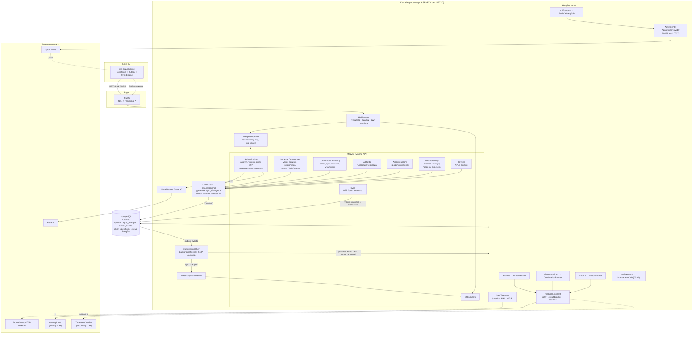
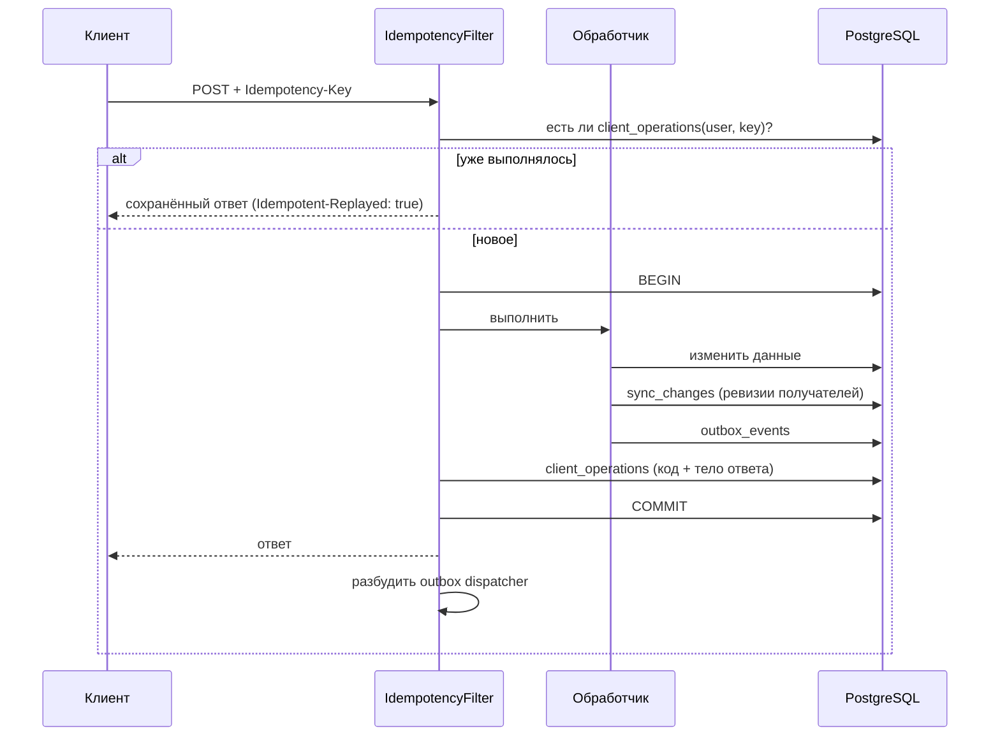

# Архитектура

## Схема взаимодействия компонентов

Один процесс API (MVP, без HA) содержит всё: HTTP API, SSE, диспетчер outbox и Hangfire server. Состояние — только в PostgreSQL; in-memory — лишь fanout SSE-сигналов.



Как читать схему:

- **Синхронный путь** (сплошные стрелки сверху вниз): запрос → middleware → фильтр идемпотентности → модуль → `UnitOfWork` → одна транзакция PostgreSQL. Ответ клиенту уходит сразу после коммита; LLM, APNs и прочие медленные операции в запросе не выполняются (исключение — email-код через Resend).
- **Асинхронный путь**: всё, что должно произойти *после* коммита, записывается в `outbox_events` в той же транзакции. `OutboxDispatcher` забирает события и либо шлёт SSE-сигнал через hub, либо ставит задачу в нужную очередь Hangfire. Задачи сами пишут результат в PostgreSQL через тот же `UnitOfWork`, и цикл повторяется (клиент узнаёт о результате через sync/SSE/push).
- **Клиент получает данные только через sync** (`GET /v1/sync`); SSE и APNs лишь сообщают, что пора синхронизироваться.

### Путь одной мутации

```mermaid
sequenceDiagram
    autonumber
    participant C as iOS
    participant API as API (фильтр + модуль)
    participant DB as PostgreSQL
    participant D as OutboxDispatcher
    participant H as Hangfire
    participant X as LLM / APNs
    C->>API: POST /v1/ai/node-drafts + Idempotency-Key
    API->>DB: BEGIN; ai_draft_jobs, sync_changes, outbox_events, client_operations; COMMIT
    API-->>C: 202 queued
    D->>DB: SELECT … FOR UPDATE SKIP LOCKED
    D-->>C: SSE sync.required
    D->>H: enqueue AiDraftRunner (ai-drafts)
    H->>X: LLM (neuroapi → Timeweb)
    H->>DB: черновики + status ready + sync_changes + outbox(push.requested)
    D-->>C: SSE sync.required
    D->>H: PushDeliveryJob (notifications)
    H->>X: APNs
    C->>API: GET /v1/sync?cursor=…
    API-->>C: ai_draft_job (ready, drafts)
```

Все внешние зависимости скрыты за интерфейсами (`ILlmClient`, `IApnsClient`, `IEmailSender`, `IRealtimeHub`, `IBackgroundJobs`), поэтому Hangfire-воркер и SSE-fanout можно позже вынести в отдельные процессы, не меняя модули.

## Модули (`Nodus.Api/`)

| Папка | Ответственность |
|---|---|
| `Authentication/` | пользователь, JWT, refresh-токены, email OTP, профиль |
| `Nodes/` | узлы, ревизии, валидация шаблона, права (`NodeAccess`), DTO |
| `Recurrence/` | правило повторения, календарная арифметика, часовые пояса |
| `Occurrences/` | ключи и состояния экземпляров, проекция истории, лента |
| `Sync/` | журнал изменений, Delta Sync, идемпотентность, unit of work |
| `Devices/` | установки приложения и APNs-токены |
| `Notifications/` | запрос push и его доставка |
| `Connections/`, `Sharing/` | доверенные связи и совместные узлы |
| `AiDrafts/`, `AiContinuations/` | AI-функции |
| `DataPortability/` | экспорт и импорт, парсеры форматов по версиям |
| `Infrastructure/` | Persistence, Outbox, Hangfire, Llm, Sse, Apns, Resend, Observability |
| `NodusApplication.cs` | composition root: регистрация сервисов, middleware, маршруты |

## Жизненный цикл запроса

Порядок middleware (`NodusApplication.Build`):

1. `ForwardedHeaders` — реальный IP и схема за reverse proxy.
2. Observability — `X-Request-Id` (берётся у клиента или генерируется), scope логов с `RequestId` и `IdempotencyKey`.
3. Обработчик исключений — `400 bad_request` для битого тела, `500 internal_error` без внутренних деталей.
4. Буферизация тела мутаций (нужно, чтобы посчитать хеш запроса для идемпотентности).
5. Аутентификация JWT → авторизация → rate limiting.
6. Endpoint, на мутациях — фильтр идемпотентности.

Пользователь определяется **только** по проверенному токену (`ClaimsPrincipal.GetUserId()`); идентификаторы из тела запроса никогда не дают доступа.

## Транзакция мутации

Это центральный механизм надёжности. Любое изменение (создать узел, развязать экземпляр, принять приглашение…) проходит так:



Ключевые классы:

- `Sync/IdempotencyFilter.cs` — открывает транзакцию, сохраняет ответ, обрабатывает гонки.
- `Sync/UnitOfWork.cs` — `CommitAsync()`: сбросить журнал изменений и сохранить. Внутри транзакции фильтра коммит делает фильтр.
- `Sync/ChangeJournal.cs` — копит изменения сущностей и при сбросе выделяет ревизии каждому получателю.

Если обработчик вернул ошибку (4xx), всё, кроме записи о самом результате, откатывается.

## Transactional outbox

`outbox_events` — таблица событий, записанных **в той же транзакции**, что и данные. Отдельный `OutboxDispatcher` (`Infrastructure/Outbox/OutboxDispatcher.cs`) забирает их:

- просыпается сразу после коммита (сигнал) или раз в `Outbox:PollSeconds` (5 с);
- выбирает пачку `FOR UPDATE SKIP LOCKED` (безопасно и для будущего второго воркера);
- вызывает обработчик по типу события; при ошибке — повтор с экспоненциальной задержкой и jitter, после `Outbox:MaxAttempts` (10) событие помечается `failed_at`.

Доставка «как минимум один раз», поэтому все обработчики идемпотентны.

| Тип события | Обработчик | Что делает |
|---|---|---|
| `sync.changed` | `SyncChangedOutboxHandler` | шлёт SSE-сигнал получателям |
| `push.requested` | `PushRequestedOutboxHandler` | ставит задачу доставки push (очередь `notifications`) |
| `ai.draft.requested` | `AiDraftRequestedOutboxHandler` | ставит разбор текста (очередь `ai-drafts`) |
| `ai.continuation.requested` | `ContinuationRequestedOutboxHandler` | откладывает конвейер продолжения (очередь `ai-continuations`) |
| `import.requested` | `ImportRequestedOutboxHandler` | ставит AI-конвертацию файла (очередь `imports`) |

Зачем это нужно: нельзя «сначала закоммитить, потом поставить задачу в Hangfire» — между этими шагами процесс может упасть, и задание потеряется. С outbox задание либо записано вместе с данными, либо не записано вообще.

## Фоновые задачи (Hangfire)

Хранилище — тот же PostgreSQL (схема `hangfire`). Очереди: `ai-drafts`, `ai-continuations`, `imports`, `notifications`, `maintenance`, `default`.

| Задача | Очередь | Когда |
|---|---|---|
| `AiDraftRunner` | `ai-drafts` | после создания AI-задания |
| `ContinuationRunner` | `ai-continuations` | через 20 с после создания/правки одноразового узла |
| `ImportRunner` | `imports` | после загрузки чужого файла на импорт |
| `PushDeliveryJob` | `notifications` | по запросу push |
| `MaintenanceJob` | `maintenance` | ежедневно в 03:00 UTC (retention) |

Задачи ставятся только через `IBackgroundJobs` (`Infrastructure/Hangfire/BackgroundJobs.cs`). Когда Hangfire выключен (тесты), используется `InlineBackgroundJobs`, который выполняет задачу сразу.

## Хранение данных

PostgreSQL, EF Core, имена в `snake_case`. Все моменты времени хранятся в UTC (`timestamptz`); любой пришедший offset нормализуется конвертером в `NodusDbContext`. Локальные даты/время — отдельно (`date`, `time`) вместе с IANA-зоной.

Основные таблицы: `users`, `refresh_tokens`, `email_verification_codes`, `nodes`, `node_revisions`, `node_occurrence_states`, `sync_changes`, `client_operations`, `outbox_events`, `devices`, `connections`, `connection_invites`, `shared_node_members`, `ai_draft_jobs`, `ai_node_drafts`, `node_suggestions`, `continuation_cache`.

Ключевые ограничения целостности:

- `client_operations (user_id, idempotency_key)` — PK;
- `node_occurrence_states (node_id, occurrence_key)` — PK;
- `connections (user_low_id, user_high_id)` — уникально + check `user_low_id < user_high_id`;
- `shared_node_members (node_id, user_id)` — PK;
- `sync_changes (recipient_user_id, revision)` — PK;
- `users.email`, `devices.apns_token`, `refresh_tokens.token_hash` — уникальны.
