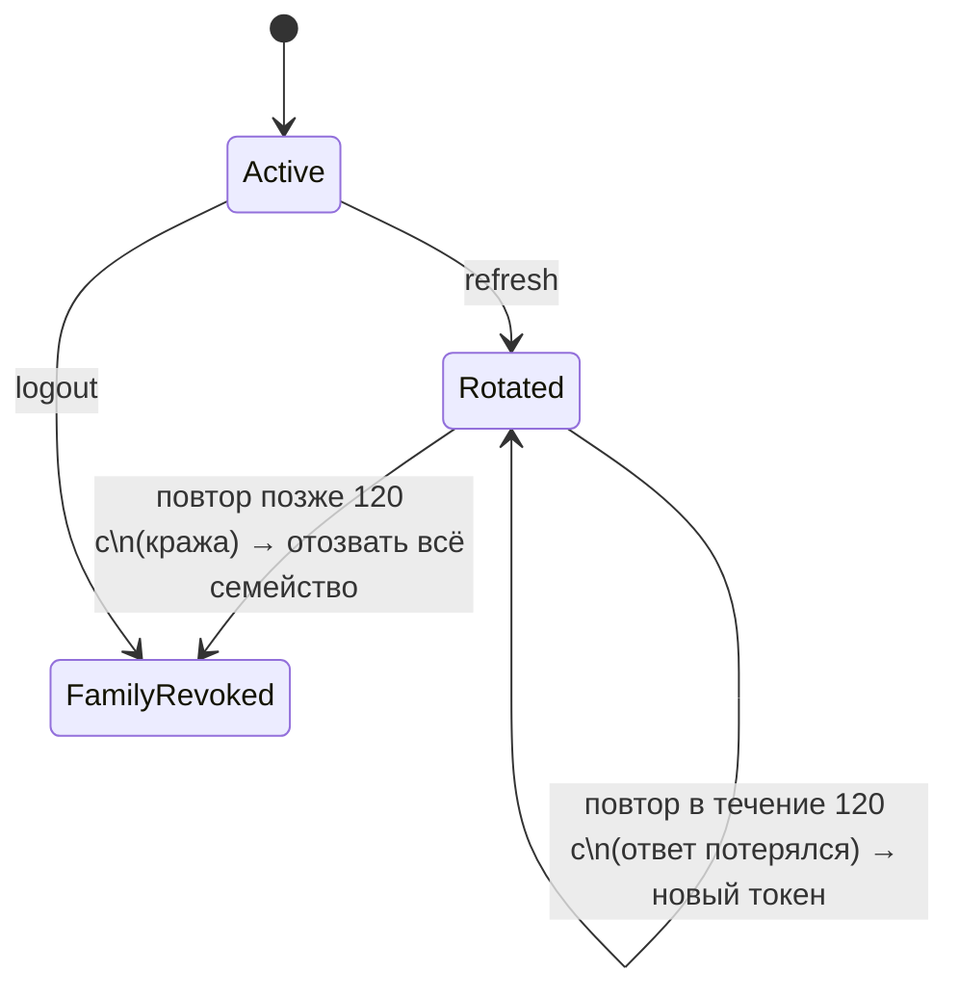

# Авторизация и аккаунт

Код: `Nodus.Api/Authentication/`.

## Анонимный аккаунт

Пользователь начинает работать без регистрации. При первой синхронизации клиент вызывает:

```http
POST /v1/auth/anonymous
```
```json
{
  "user_id": "9c78…",
  "access_token": "eyJ…", "access_token_expires_at": "…",
  "refresh_token": "Xy…", "refresh_token_expires_at": "…",
  "token_type": "Bearer"
}
```

Создаются `users` (`is_anonymous = true`) и первая сессия refresh-токена. Ограничение — `RateLimits:AuthPerMinute` с одного IP.

## Токены

| | Access | Refresh |
|---|---|---|
| Формат | JWT HS256 (`sub` = user id, `sid` = id сессии, `jti`) | 256 бит случайных данных, base64url |
| Срок | `Jwt:AccessTokenMinutes` (15 мин) | `Jwt:RefreshTokenDays` (60 дней), продлевается при каждой ротации |
| Хранение на сервере | не хранится | только SHA-256 хеш |

Проверка access-токена: issuer, audience, подпись HS256, срок жизни по часам приложения (`TimeProvider`), допуск 30 с. Неподписанные токены, токены с чужим ключом или audience отклоняются (`401 unauthorized`).

### Ротация refresh-токена

```http
POST /v1/auth/refresh   { "refresh_token": "…" }
```

Каждый refresh-токен принадлежит **семейству** (одна установка приложения). При обновлении старый токен помечается `rotated` и выдаётся новый того же семейства.



- **Гонка двух refresh** с одним токеном: обновление делается условным `UPDATE … WHERE revoked_at IS NULL`, ротирует только один запрос; второй попадает в окно «потерянного ответа».
- **Окно потерянного ответа** (`Jwt:RotationGraceSeconds`, 120 с): клиент мог не получить ответ из-за обрыва сети и повторяет старый токен — ему выдаётся ещё один токен, а не разлогин.
- **Повторное использование позже** — признак кражи: всё семейство отзывается, оба (вор и владелец) должны войти заново.
- `POST /v1/auth/logout { refresh_token }` отзывает семейство.

## Привязка email (тот же UserId)

Используется механика кодов, которая была в проекте для восстановления подписки через Resend, но теперь она привязана к `UserId`.

```http
POST /v1/auth/email/start   { "email": "a@b.c" }          → 202 (всегда одинаковый ответ)
POST /v1/auth/email/verify  { "email": "a@b.c", "code": "123456" } → профиль
```

- Код: 6 цифр, срок `EmailOtp:CodeExpiryMinutes` (10 мин), хранится как HMAC-SHA256 с секретным pepper.
- Повторная отправка не чаще раза в `ResendCooldownSeconds` (60 с) и не больше `MaxCodesPerHour` (5) на email.
- Не больше `MaxAttempts` (5) попыток ввода, сравнение за постоянное время.
- После успешной проверки у **того же** пользователя ставится `email`, `email_verified_at`, `is_anonymous = false`. Данные никуда не мигрируют.
- Если email уже привязан к другому аккаунту → `409 email_already_linked`. Аккаунты автоматически не сливаются.

## Восстановление аккаунта на другом устройстве

Сценарий — новое устройство или переустановка приложения: пользователь возвращается в свой аккаунт по подтверждённому email.

```http
POST /v1/auth/email/sign-in/start   { "email": "a@b.c" }   → 202
POST /v1/auth/email/sign-in/verify  { "email", "code" }   → токены этого аккаунта
```

- Код отправляется, только если аккаунт с таким подтверждённым email существует, но ответ всегда одинаковый — по нему нельзя узнать, зарегистрирован ли email.
- Анонимный аккаунт, которым устройство пользовалось до входа, не сливается; клиент его отбрасывает.
- Рекомендация клиенту: предлагать «Восстановить аккаунт» на первом запуске, до создания узлов; если локальные данные уже есть — предупредить, что они не перенесутся.
- Анонимный аккаунт без привязанного email восстановить нельзя — это нужно объяснить пользователю.

## Профиль

```http
GET   /v1/me
PATCH /v1/me   { "display_name": "Аня" }    (Idempotency-Key)
```

`display_name` (до 60 символов) видят доверенные связи и участники совместных узлов. Изменение имени попадает в sync самого пользователя и его связей.

## Удаление аккаунта

```http
DELETE /v1/me        → 204
```

Необратимое удаление (требование App Store 5.1.1(v)), `AccountDeletionService`. Без `Idempotency-Key`: записи идемпотентности удаляются вместе с аккаунтом.

Что удаляется (каскадом от `users` в одной транзакции): refresh-токены, устройства, свои узлы с ревизиями, состояниями, участниками и предложениями, связи и приглашения, AI-задания с черновиками, журнал синхронизации, записи идемпотентности, email-коды.

Что видят другие люди (журналируется до удаления, приходит им через sync/SSE):

| Кто | Что получает |
|---|---|
| участники совместных узлов удалённого пользователя | tombstone узла — узел у них пропадает |
| владельцы и участники узлов, где удалённый был участником | узел с обновлённым списком `members` |
| его связи | tombstone связи |

Остаются только обезличенные UUID в чужих данных (например, «кто развязал» в совместном узле другого владельца) и общий кеш продолжений, в котором нет персональных данных.

Токены перестают работать сразу: при каждом запросе проверяется, что пользователь из токена существует (результат кешируется в памяти на минуту и сбрасывается при удалении). Повтор `DELETE` после потерянного ответа получит `401` — клиент трактует это как «аккаунт удалён», очищает Keychain и локальную БД. Освободившийся email можно снова привязать к другому аккаунту.

## Rate limits

| Политика | Где | Ключ | По умолчанию |
|---|---|---|---|
| `auth` | anonymous, refresh, logout | IP | 20/мин |
| `otp` | email-коды, приглашения | IP | 10/мин |
| `ai` | создание AI-заданий | пользователь | 10/мин |

Превышение → `429 rate_limited`.
