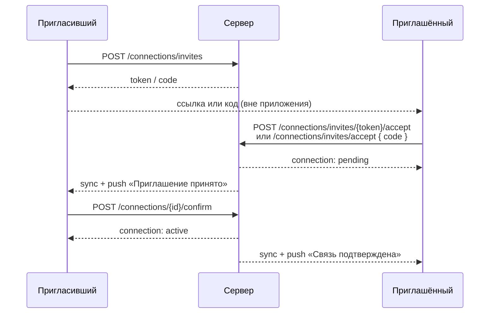

# Доверенные связи и совместные узлы

Код: `Connections/`, `Sharing/`, права — `Nodes/NodeAccess.cs`.

## Связь (Connection)

Между двумя пользователями существует **одна** каноническая запись: пара нормализуется (`user_low_id < user_high_id`) и защищена уникальным индексом и check-ограничением. Статусы:

| Статус | Значение |
|---|---|
| `pending` | приглашение принято, ждём подтверждения пригласившего |
| `active` | связь установлена, можно делиться узлами |
| `removed` | связь разорвана или отклонена |

## Приглашение

```http
POST /v1/connections/invites            (Idempotency-Key)
```
```json
{ "id": "…", "token": "Xy…", "code": "K7M2Q9TP", "link": "https://nodus.app/invite/Xy…", "expires_at": "…" }
```

- Два способа передать: **ссылка** (токен 256 бит) или **код** из 8 символов (алфавит Crockford base32 без похожих букв, ~10¹² вариантов) — продиктовать или ввести на другом телефоне.
- Срок — `Connections:InviteLifetimeHours` (24 ч), одноразовое, не больше `MaxPendingInvites` (10) активных у пользователя.
- В БД только хеши: токена — SHA-256, кода — HMAC с секретным pepper.
- `DELETE /v1/connections/invites/{id}` — отозвать.
- Rate limit `otp` на создание и принятие.

## Установка связи



Подтверждение пригласившим — вторая сторона взаимного согласия: ссылка могла попасть не к тому человеку.

Особые случаи:

| Случай | Результат |
|---|---|
| Принять своё приглашение | `400 own_invite` |
| Приглашение использовано, отозвано, истекло или не существует | `404 invite_invalid` — все случаи неразличимы |
| Уже есть активная связь | `409 already_connected` |
| **Встречные приглашения**: A пригласил B, B пригласил A | B принимает приглашение A → `pending` (ждёт A). Затем A принимает приглашение B → обе стороны согласились, связь сразу `active`. Запись одна. |
| Одновременные принятия | приглашение и пара блокируются (`FOR UPDATE`); при гонке второй запрос получает `409 conflict`, повтор видит итоговое состояние |
| Ранее разорванная связь | та же запись переходит обратно в `pending` |

`GET /v1/connections` — список; для каждой связи: `user_id` и `display_name` другого человека, `status`, `invited_by_me`, `awaiting_my_confirmation`.

`DELETE /v1/connections/{id}` — отклонить или разорвать (любая сторона). При разрыве **снимается совместный доступ** между этими двумя людьми: узлы, которые один из них расшарил другому, перестают быть общими, и тот, кто потерял доступ, получает tombstone.

## Совместные узлы

```http
POST   /v1/nodes/{id}/members            { "user_id": "…" }   (Idempotency-Key)
DELETE /v1/nodes/{id}/members/{userId}                           (Idempotency-Key)
```

Политика прав:

| Действие | Владелец | Участник |
|---|---|---|
| Видеть, редактировать шаблон | ✓ | ✓ |
| Развязать / перевязать экземпляр | ✓ | ✓ |
| Добавить участника | ✓ (только из `active`-связей) | — `403` |
| Удалить участника | ✓ любого | только себя (выйти) |
| Удалить узел | ✓ | — `403` |

- Поделиться можно только с активной связью, иначе `409 not_connected`.
- Состав участников — часть узла (`members` в `NodeDto`), поэтому любое изменение увеличивает `version` и рассылается всем участникам через sync.
- Новый участник получает узел в sync и push «Новый совместный узел».
- Удалённый участник получает tombstone; `GET` узла для него → `404`.
- Одновременные правки разрешаются через `expected_version` → `409` с каноническим состоянием, см. [04](04-sync-and-idempotency.md#версии-и-конфликты).

## Проверка доступа

Всё проходит через `NodeAccess`:

- `Accessible(userId)` — узлы, где пользователь владелец **или** участник. Используется в каждом endpoint узлов, в ленте и при сборке sync.
- `RecipientsAsync(node)` — владелец + все участники; им пишутся записи журнала.
- Для постороннего чужой узел неотличим от несуществующего (одинаковый `404`), поэтому перебором id ничего не узнать. Попытка создать узел с занятым id → `409 node_already_exists` без раскрытия владельца.
