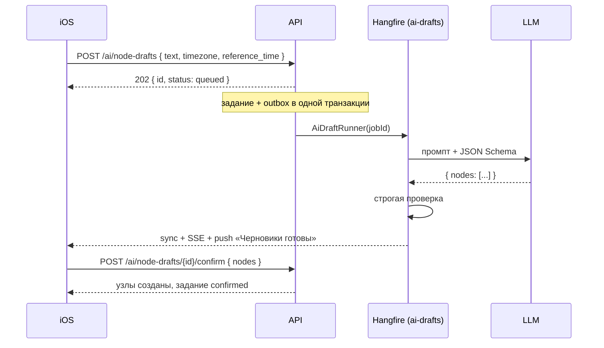
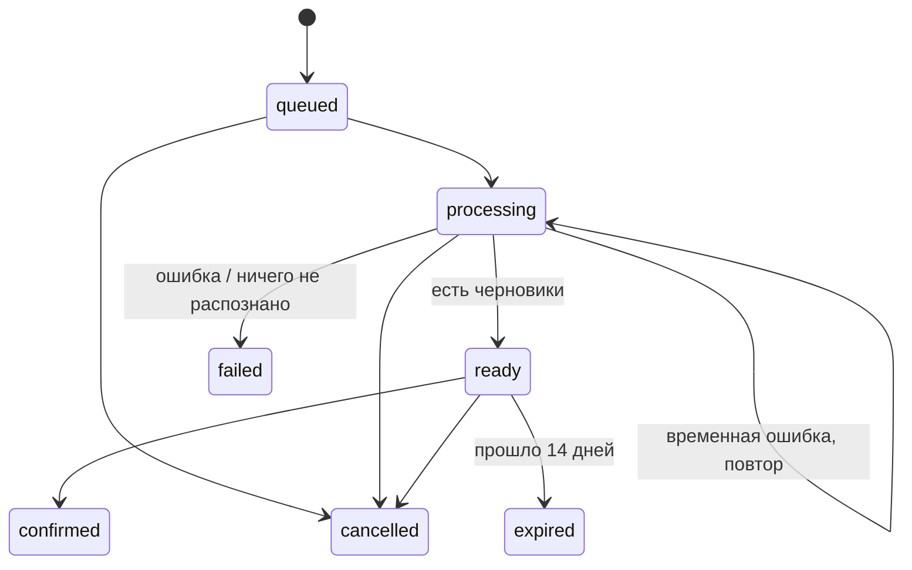

# AI: голосовой разбор в черновики

Код: `AiDrafts/`, LLM — `Infrastructure/Llm/`.

Пользователь диктует фразу («завтра купить хлеб и каждый день делать зарядку»), iOS распознаёт речь в текст, сервер превращает текст в **черновики** узлов. AI никогда не создаёт узлы сам — только после подтверждения.

## Поток



После `202` экран можно закрывать: задание уже сохранено и не потеряется.

## API

| Запрос | Что делает |
|---|---|
| `POST /v1/ai/node-drafts` `{ text, timezone, reference_time }` | создать задание (`Idempotency-Key`, rate limit `ai`, функция `ai_drafts`) |
| `GET /v1/ai/node-drafts` | раздел «Черновики»: задания `queued`, `processing`, `ready` |
| `GET /v1/ai/node-drafts/{jobId}` | статус и черновики |
| `POST /v1/ai/node-drafts/{jobId}/confirm` `{ nodes? }` | подтвердить |
| `POST /v1/ai/node-drafts/{jobId}/cancel` | отменить |

Доступ: функция `ai_drafts` в плане и согласие на AI, иначе `403 feature_not_available` / `403 ai_consent_required` — проверяется до идемпотентности, ключ не сохраняется ([11-plans-and-features.md](11-plans-and-features.md)). Остальные запросы раздела доступны всегда, чтобы начатые задания не терялись при потере доступа.

Проверки входа: текст 1–4000 символов, IANA-зона, `reference_time` не дальше двух суток от текущего времени. Не больше `Ai:MaxJobsPerDay` (50) заданий в сутки → `429 ai_quota_exceeded`.

`reference_time` — момент, когда пользователь говорил. Относительно него разрешаются «завтра», «в пятницу», а не относительно времени обработки.

## Статусы задания



`ready` **не** означает, что узлы созданы. Коды ошибок (`error`): `ai_unavailable` (нет/неверно настроен провайдер), `ai_temporarily_unavailable`, `invalid_ai_response`, `nothing_recognized`, `input_expired`, `timed_out`.

## Обработка (`AiDraftRunner`)

Жизненный цикл общий с AI-импортом — базовый класс `Infrastructure/Llm/AiJobRunner.cs`; конкретный runner задаёт только промпт, разбор ответа, сохранение результата и тексты push. Итоги считаются в метрике `nodus.ai.jobs` (`kind`, `outcome`).

- Задание берётся, только если оно `queued`/`processing` — повторная постановка или повтор после сбоя ничего не дублирует; старые черновики задания перезаписываются.
- Временная ошибка LLM (сеть, таймаут, 429, 5xx, невалидный ответ) → повтор Hangfire, всего до `Ai:MaxAttempts` (3) попыток, затем `failed`.
- Постоянная ошибка (нет провайдера, неверный ключ, отклонённый payload) → сразу `failed`.
- После ответа модели задание перечитывается с блокировкой: если его отменили, пока модель думала, результат отбрасывается.

## Черновик и проверка ответа модели

Модели передаётся JSON Schema (или JSON-режим, если провайдер не поддерживает схемы) и правила: каждое намерение отдельно, относительные даты → абсолютные, **не выдумывать** отсутствующие дату/время, неоднозначное («утром», «на днях») оставлять пустым и описывать в `ambiguities`.

Сервер не доверяет ответу и проверяет его (`NodeDraftParser`) теми же правилами, что и создание узла. Всё, что не удалось, становится **замечанием** (`issues`), а не догадкой:

```json
{
  "index": 0, "type": "one_time", "title": "Позвонить врачу", "description": null,
  "timezone": "Europe/Moscow", "date": null, "time": null, "recurrence": null, "track_years": null,
  "issues": [
    { "code": "time_without_date", "field": "date", "message": "Указано время, но не дата." },
    { "code": "ambiguous", "field": null, "message": "Не ясно, какой день" }
  ]
}
```

| `code` | Когда |
|---|---|
| `missing_recurrence` | повторяющееся без понятного правила — черновик становится одноразовым без даты |
| `invalid_recurrence`, `invalid_date`, `invalid_time` | поле не распознано и очищено |
| `time_without_date` | время без даты — время очищено |
| `missing_date` | годовщина без даты |
| `past_date` | дата уже прошла |
| `ambiguous` | неоднозначность, описанная моделью |
| `needs_review` | черновик пока не пройдёт создание узла — его надо дополнить |

Не больше 20 черновиков на задание; пустые названия отбрасываются.

## Подтверждение

Два варианта:

1. **Атомарно:** `POST …/confirm { "nodes": [ CreateNodeRequest… ] }` — узлы (отредактированные пользователем) создаются и задание переходит в `confirmed` **в одной транзакции**. Ошибка валидации любого узла → ничего не создано, задание остаётся `ready`.
2. Клиент сам создал узлы через `POST /v1/nodes/batch`, затем `confirm` без `nodes`.

Повтор `confirm` с тем же ключом возвращает тот же ответ, узлы не дублируются.

## Уведомление

Готовность → запись в sync (`ai_draft_job`) + SSE + push с `job_id` и нейтральным текстом. Ни черновики, ни исходная речь в push не попадают. Если push не дошёл, черновики всё равно видны в разделе «Черновики» и в sync.

## Приватность и хранение

- Исходный текст не возвращается в API и не логируется; стирается через `Ai:InputRetentionHours` (24 ч) после создания, как только задание не в обработке.
- Черновики неподтверждённых заданий истекают через `Ai:DraftRetentionDays` (14 дней).
- Задания, застрявшие в обработке больше 2 часов (потерянный воркер), переводятся в `failed / timed_out`, чтобы клиент перестал ждать.

## LLM-клиент с двумя провайдерами

Код вызывает только `ILlmClient.GenerateAsync` (`FallbackLlmClient`); endpoint'ы не обращаются к провайдерам напрямую. Провайдеры — OpenAI-совместимые (`/v1/chat/completions`, Bearer-ключ):

| Порядок | Провайдер | Base URL |
|---|---|---|
| 1 | neuroapi.host | `https://neuroapi.host` |
| 2 | Timeweb Cloud AI Gateway | `https://api.timeweb.ai` |

Провайдер без ключа или модели пропускается. Настраиваются для каждого: модель, endpoint, ключ, таймаут попытки, число попыток, поддержка JSON Schema, лимит запросов в минуту, цена за 1M токенов.

| Ошибка провайдера | Повтор | Переключение на следующего |
|---|---|---|
| Сеть, таймаут, 5xx, невалидный ответ | да (backoff + jitter) | да |
| 429 (у провайдера или локальный лимит) | нет | да, сразу |
| 400/4xx — отклонён наш payload | нет | **нет** |
| 401/403 — неверные ключи | нет | **нет** (это проблема конфигурации) |

Дополнительно:

- **Circuit breaker:** после `Llm:CircuitFailureThreshold` (5) временных ошибок подряд провайдер пропускается `CircuitBreakSeconds` (60 с).
- Общий дедлайн на вызов — `Llm:TotalTimeoutSeconds` (150 с) на все попытки и провайдеров.
- Метрики: провайдер, модель, задержка, токены, оценка стоимости, категория ошибки. Промпты и ответы не логируются (`Llm:LogContent=false`).
