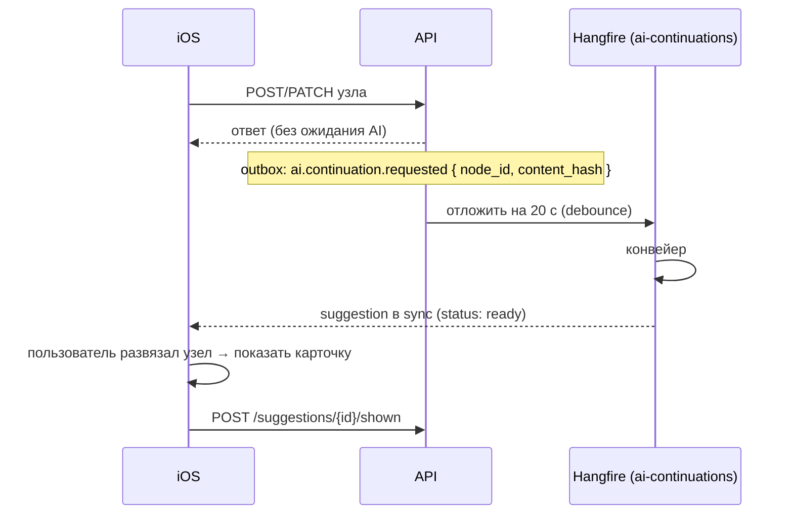

# AI: «Продолжение нити»

Код: `AiContinuations/`.

Когда пользователь создаёт или по смыслу меняет одноразовый узел, сервер **заранее** готовит возможный следующий шаг: «Записаться к врачу» → «Визит к врачу». Предложение заранее приходит на устройство через sync, поэтому при развязывании карточка показывается мгновенно, без ожидания AI. Предложение показывается **один раз**; узел создаётся только если пользователь принял предложение.

## Когда запускается



- **Хеш содержимого** — от нормализованных названия и описания (регистр, `ё/е`, пунктуация не учитываются). Перенос даты/времени хеш не меняет, поэтому конвейер не перезапускается.
- **Debounce** `AiContinuations:DebounceSeconds` (20 с): задача обрабатывает только **текущее** содержимое; если узел успели изменить, старая задача ничего не делает.
- Смысловая правка или удаление узла сразу помечают прежнее не принятое предложение `stale` — клиент получает tombstone и не покажет устаревшую карточку.

## Конвейер

```
HardFilter → SemanticRules → Templates → NormalizedCache → LLM
```

| Шаг | Что проверяет | Итог |
|---|---|---|
| **HardFilter** | узел одноразовый, не удалён, ещё не развязан, не совместный (MVP), содержимое не изменилось | иначе — ничего не делаем |
| **SemanticRules** | название начинается с подготовительного действия: «записаться», «забронировать», «купить билет», «заказать», «подать заявку/документы», «отправить резюме/заявку/документы», «назначить», «договориться о», «оформить», «зарегистрироваться на», «запланировать»… | нет признака → **Skip**, модель не вызывается |
| **Templates** | известные обобщённые сценарии | ответ без модели |
| **NormalizedCache** | общий кеш по нормализованному названию | ответ без модели (в том числе «продолжения нет») |
| **LLM** | промпт: предлагать только очевидный следующий шаг, иначе `null`; не выдумывать даты, имена, места | предложение или Skip |

Политика консервативная: если явного признака нет — Skip. Регулярные, ежегодные, совместные и уже развязанные узлы в MVP пропускаются.

### Шаблоны (примеры)

| Название | Предложение |
|---|---|
| Записаться к врачу / стоматологу / терапевту / парикмахеру… | Визит к врачу / … |
| Записаться на МРТ / стрижку / анализы / собеседование… | Сходить на мрт / … |
| Купить билеты в театр / на концерт / в кино… | Сходить в театр / … |
| Забронировать отель / гостиницу / жильё | Заселиться |
| Забронировать столик | Сходить в ресторан |
| Назначить встречу / собеседование / созвон | Провести встречу / … / Созвониться |

Шаблоны версионируются (`continuation-templates-v1`), промпт — `continuation-v1`.

### Ответ модели

Ожидается `{"continuation": {"title": "…"}}` или `{"continuation": null}`. Ответ отбрасывается, если это не JSON, если название короче 2 или длиннее 80 символов, или если оно повторяет исходное дело. Ошибки LLM не повторяются (отсутствие подсказки допустимо, повторы только тратят деньги).

После ответа модели узел перечитывается: если содержимое изменилось, удалено, развязано или узел стал совместным, результат **отбрасывается**.

## Кеш без персональных данных

Таблица `continuation_cache`:

- ключ — HMAC-SHA256 (с секретным pepper) от версии промпта и нормализованного названия: по ключу не восстановить текст;
- значение — обобщённое продолжение или `null` (отрицательный кеш);
- запись делается, только если название **не похоже на персональное**: нет цифр, нет слов с заглавной буквы после первого (имена, места), не больше 8 слов и нет описания.

Например, «Заказать торт» кешируется, «Заказать торт для Маши» и «Заказать 3 торта» — нет. Неиспользуемые 180 дней записи удаляются.

## Лимиты

- Не больше `AiContinuations:MaxLlmCallsPerUserPerDay` (30) вызовов модели на пользователя в сутки; сверх лимита — Skip.
- `AiContinuations:Enabled=false` выключает функцию целиком.

## Предложение на клиенте

`entity_type: suggestion` в sync:

```json
{ "id": "…", "source_node_id": "…", "status": "ready", "title": "Визит к врачу", "description": null,
  "shown_at": null, "accepted_at": null, "dismissed_at": null, "linked_node_id": null, "version": 1 }
```

Клиенту видны статусы `ready`, `accepted`, `dismissed`. `skipped` и `stale` до него не доходят (или приходят tombstone, если раньше были видны).

| Запрос | Что делает |
|---|---|
| `POST /v1/suggestions/{id}/shown` | зафиксировать показ; повторные вызовы сохраняют первый `shown_at` |
| `POST /v1/suggestions/{id}/accept` `{ node: CreateNodeRequest }` | **одна** операция: создать (возможно отредактированный) узел и пометить предложение принятым |
| `POST /v1/suggestions/{id}/dismiss` | отклонить |

Все три — с `Idempotency-Key`.

Правила показа на клиенте:

- показать карточку при развязывании, только если предложение `ready` и `shown_at` пустой;
- показ записать локально вместе с действием развязывания и отправить `shown` через outbox;
- после перевязывания повторно не показывать;
- если готового предложения нет — развязывание не ждёт AI, поздняя карточка на уже закрытом экране не появляется.

### Принятие

Связь «новый узел ← исходный» хранится в предложении: `source_node_id` → `linked_node_id`. Принятое предложение синхронизируется на устройство и не перезаписывается при последующих правках исходного узла, поэтому отдельного поля `previous_node_id` у узла нет.

Не делайте два отдельных запроса «создать узел» и «принять предложение» — используйте `accept` с узлом: это атомарно и идемпотентно, офлайн-клиент кладёт его в outbox одной записью. Повторное принятие другим ключом → `409 already_accepted` с `linked_node_id`. Созданный узел — обычный одноразовый узел, для него тоже может появиться своё продолжение (нить продолжается).
