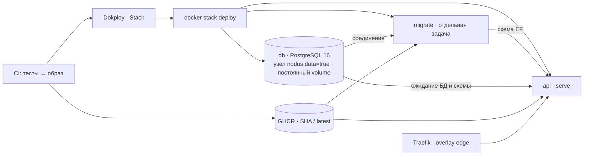

# Эксплуатация

## Конфигурация

Значения по умолчанию — в `Nodus.Api/appsettings.json`. Переопределение — через environment: `Секция__Ключ`, элементы списков по индексу (`Llm__Providers__0__ApiKey`). Обязательные настройки — `ConnectionStrings__Postgres`, `Jwt__SigningKey`, `EmailOtp__HashPepper`, в Production Live также `EmailOptions__Smtp__Host`; без них приложение не стартует. SMTP — [14-smtp.md](14-smtp.md). Для работы без почты включить Email=Mock с секретным MockCode: [15-service-modes.md](15-service-modes.md).

**Все переменные с описаниями и значениями по умолчанию — [13-environment.md](13-environment.md).**

## Запуск локально

```bash
docker run -d --name nodus-test-pg -p 55432:5432 -e POSTGRES_USER=nodus -e POSTGRES_PASSWORD=nodus -e POSTGRES_DB=nodus postgres:16
export ConnectionStrings__Postgres="Host=localhost;Port=55432;Database=nodus;Username=nodus;Password=nodus"
export Jwt__SigningKey="$(openssl rand -base64 48)"
export EmailOtp__HashPepper="$(openssl rand -base64 24)"
dotnet run --project Nodus.Api -- migrate
dotnet run --project Nodus.Api
```

## Миграции

EF Core, `Nodus.Api/Infrastructure/Persistence/Migrations/`. API **не** применяет миграции при старте — это отдельный шаг релиза:

```bash
dotnet run --project Nodus.Api -- migrate      # локально
docker run --env-file .env nodus-api migrate   # в контейнере
```

Новая миграция: `cd Nodus.Api && dotnet ef migrations add <Name> -o Infrastructure/Persistence/Migrations`.

## Выдача плана Nodus+

```bash
dotnet run --project Nodus.Api -- plan set --email user@example.com --plan plus [--expires 2027-01-01T00:00:00Z]
dotnet run --project Nodus.Api -- plan set --user-id <uuid> --plan standard
dotnet run --project Nodus.Api -- plan list
docker exec <API_CONTAINER_ID> dotnet Nodus.Api.dll plan set --email user@example.com --plan plus   # задача Swarm api
```

Подробности и коды выхода — [11-plans-and-features.md](11-plans-and-features.md#выдача-плана).

## Конфигурация клиента

```bash
dotnet run --project Nodus.Api -- config set links.privacy_policy https://nodus.app/privacy
dotnet run --project Nodus.Api -- config set features.import_enabled false --json
dotnet run --project Nodus.Api -- config list
docker exec <API_CONTAINER_ID> dotnet Nodus.Api.dll config set min_supported_version 1.2.0   # задача Swarm api
```

Клиенты увидят изменение в течение `AppConfig:CacheSeconds`. Подробности — [12-app-config.md](12-app-config.md).

До первого развёртывания все миграции схлопнуты в одну `InitialCreate`; дальше — только новые миграции поверх, уже выпущенные не редактируются. CI проверяет, что модель и миграции совпадают (`dotnet ef migrations has-pending-model-changes`).

## CI/CD (GitHub Actions)

`.github/workflows/deploy.yml`, по схеме eatee-backend. Запускается только при мердже в `main`; пуши в `dev` CI не запускают — тесты там гоняются локально перед коммитом. Деплои идут по одному (новый мердж ждёт текущий, не отменяет его).

| Задача | Когда | Что делает |
|---|---|---|
| `test` | мердж (push) в `main` | restore, build Release, проверка миграций, `dotnet test` на PostgreSQL 16 (сервис в job, `NODUS_TEST_POSTGRES`), отчёт `.trx` в артефактах |
| `deploy` | тот же запуск, **только после зелёного `test`** | сборка образа (`GIT_SHA`, `BUILD_TIME`), push в GHCR с тегами `latest` и SHA коммита, вызов Dokploy `compose.deploy` |

Секреты репозитория: `DOKPLOY_URL` (например, `https://deploy.example.ru`), `DOKPLOY_API_TOKEN`, `DOKPLOY_COMPOSE_ID`. `GITHUB_TOKEN` выдаётся автоматически (права `packages: write`).

Откат — передеплой предыдущего тега `ghcr.io/petriashvili-dev/nodus-backend:<sha>`.

## Docker Swarm Stack

- `Nodus.Api/Dockerfile` — multi-stage, non-root, команда по умолчанию `serve`: ждёт актуальной схемы БД и запускает API. `migrate` ждёт БД и применяет миграции отдельной задачей.
- `docker-compose.yml` — production **Stack v3.8**, готовый образ GHCR; в Dokploy выбрать Compose Type = Stack.
- `docker-compose.local.yml` — обычный локальный Compose со сборкой, API на `127.0.0.1:8080`.
- Запуск, переменные, узел/volume PostgreSQL, Traefik, обновление и команды — [16-swarm-stack.md](16-swarm-stack.md).

### Схема развёртывания



Swarm не упорядочивает сервисы через depends_on: мигратор ждёт БД, новый API ждёт отсутствия pending migrations своего образа. У мигратора отключён HTTP healthcheck. Порты на хост не публикуются; наружу API доступен через Traefik на 8080, metrics — только внутри сети на 9464. PostgreSQL — только во внутренней overlay-сети.

API работает в одной реплике, update/rollback — stop-first; есть короткий перерыв при обновлении. Миграции должны быть обратно совместимыми, поскольку старый API может ещё работать во время обновления схемы. Откат образа не откатывает БД.

```bash
# На manager, с заранее загруженными Environment-переменными:
docker stack config --compose-file docker-compose.yml > /dev/null
docker stack deploy --with-registry-auth --compose-file docker-compose.yml nodus
docker service logs nodus_migrate
docker service logs nodus_api
# Локальная разработка:
docker compose -f docker-compose.local.yml up -d --build
```

API и мигратор получают Environment Dokploy через `env_file: .env`; короткий `environment` задаёт вычисляемые и инфраструктурные параметры. В текущем Stack подстановок нет; при ручном CLI-запуске достаточно `.env` рядом с файлом. Для первой установки выбрать и пометить узел БД; volume, база и таблицы создаются автоматически. Все значения и TODO — [17-production-environment.md](17-production-environment.md). При переносе существующей БД отдельно выбрать её volume или восстановить backup. API подключён к существующим eatee-proxy и eatee-mail; размещение — на сервере Eatee.

## Health и остановка

- `GET /health/live` — процесс жив.
- `GET /health/ready` — есть связь с PostgreSQL.
- `GET /version` — `{ version, commit, build_time }`: какой коммит задеплоен (из build-args образа).
- На SIGTERM у SSE и воркеров Hangfire есть 30 с на завершение (`stop_grace_period` 40 с в compose). Клиенты SSE переподключаются и догоняют через sync.

## Хранение данных (retention)

Ежедневная задача `MaintenanceJob` (Hangfire, 03:00 UTC):

| Что | Срок | Параметр |
|---|---|---|
| Записи идемпотентности | 30 дней | `Retention:IdempotencyDays` |
| Журнал синхронизации (старше → `410` и snapshot) | 90 дней | `Retention:SyncChangeDays` |
| Обработанные события outbox | 7 дней | `Retention:ProcessedOutboxDays` |
| Email-коды | 7 дней после истечения | `Retention:EmailCodeDays` |
| Истёкшие refresh-токены | сразу | — |
| Текст AI-диктовки | 24 ч | `Ai:InputRetentionHours` |
| Неподтверждённые AI-черновики | 14 дней → `expired` | `Ai:DraftRetentionDays` |
| Зависшие AI-задания | 2 ч → `failed` | — |
| Кеш продолжений | 180 дней без использования | `Retention:ContinuationCacheDays` |
| Текст импортируемого файла | сразу после AI-конвертации | — |
| Неподтверждённый предпросмотр AI-импорта | 7 дней → `expired` | `Import:PreviewRetentionDays` |

Корректность не зависит от того, запустилась ли задача вовремя.

## Резервные копии

Контейнер задачи БД найти на её узле: `docker ps --filter label=com.docker.swarm.service.name=nodus_db`. Если Stack называется иначе, заменить префикс nodus_. Пользователя и базу подставить из POSTGRES_USER/POSTGRES_DB.

```bash
docker exec <DB_CONTAINER_ID> pg_dump -U nodus -Fc nodus > nodus-$(date +%F).dump
```

Проверка восстановления — регулярно, в отдельную БД:

```bash
docker exec <DB_CONTAINER_ID> createdb -U nodus nodus_restore_check
docker exec <DB_CONTAINER_ID> pg_restore -U nodus -d nodus_restore_check < nodus-YYYY-MM-DD.dump
docker exec <DB_CONTAINER_ID> psql -U nodus -d nodus_restore_check -c "select count(*) from users; select max(revision) from sync_changes;"
```

## Логи

- Вне Development — JSON в stdout, время в UTC, со scope `RequestId` (из `X-Request-Id` клиента или сгенерированный, возвращается в ответе) и `IdempotencyKey`.
- **Не логируются**: содержимое узлов, текст диктовки, промпты и ответы LLM, токены и коды.

## Метрики

OpenTelemetry: `Observability:PrometheusEnabled=true` открывает `/metrics` (закройте его от интернета на proxy), `Observability:OtlpEndpoint` включает экспорт метрик и трассировок по OTLP.

| Метрика | Теги |
|---|---|
| `nodus.llm.requests`, `nodus.llm.latency` (мс) | `provider`, `purpose`, `outcome` |
| `nodus.llm.tokens` | `provider`, `kind` (prompt/completion) |
| `nodus.llm.cost` | `provider` |
| `nodus.outbox.events` | `type`, `outcome` (processed/failed/abandoned) |
| `nodus.outbox.lag` (с) | `type` — задержка от коммита до обработки |
| `nodus.idempotency.replays` | — |
| `nodus.sync.requests` | `kind` (delta/snapshot) |
| `nodus.push.deliveries` | `outcome` |
| `nodus.continuations` | `outcome` (ready/skipped × template/cache/llm) |
| `nodus.ai.jobs` | `kind` (drafts/import), `outcome` (ready, retry, discarded или код ошибки) |
| `nodus.feature.denied` | `feature`, `reason` (not_in_plan/consent_required) |

Плюс стандартные метрики ASP.NET Core, HttpClient и runtime.

## Ограничения MVP

Один экземпляр API, без HA: отказ контейнера или сервера останавливает sync, SSE и фоновые задачи. iOS продолжает работать локально, оба outbox (клиента и сервера) догоняют после восстановления. Для масштабирования: вынести Hangfire server в отдельный процесс, заменить `InMemoryRealtimeHub` на LISTEN/NOTIFY или брокер.

## Тесты

`TestApp` использует фиксированное время `2026-10-18T12:00:00.123456Z` через `ManualTimeProvider`. Шесть знаков дробной секунды соответствуют микросекундной точности PostgreSQL: первый ответ API и повторное чтение даты из БД сравниваются строго, без зависимости от точности системных часов Linux/macOS. Временные сценарии явно меняют часы через `Set` / `Advance`; `UtcNow` для начального времени фикстуры не используется.

```bash
dotnet test        # нужен PostgreSQL на 55432 или NODUS_TEST_POSTGRES
```

| Набор | Что покрывает |
|---|---|
| `Recurrence/*` | календарь, конец месяца, високосный год, DST, история правок, случайные правила (property-based) |
| `Integration/AuthTests` | анонимный вход, ротация и reuse refresh, email, вход на новом устройстве |
| `Integration/NodeSyncTests` | идемпотентность и гонки, конфликты версий, batch, untie, курсор/tombstones, изоляция пользователей |
| `Integration/RealtimeAndPushTests` | устройства, push и мёртвые токены, SSE |
| `Integration/SharingTests` | приглашения, встречные приглашения, права участников, отзыв доступа |
| `Integration/AiDraftTests`, `Ai/*` | AI-задания, fallback LLM, разбор ответа, подтверждение |
| `Integration/ContinuationTests` | конвейер, кеш, устаревание, принятие |
| `Integration/PlanTests`, `Plans/*` | доступ по плану и согласию, истечение плана, отказ без сохранения ключа, неявный запуск продолжений, сохранение начатых заданий, sync профиля, команда `plan` |
| `Notifications/EmailLoggingTests` | коды из писем не попадают в логи вне Development, Production Live без SMTP host не стартует |
| `Notifications/SmtpEmailSenderTests`, `Integration/SmtpAuthenticationTests` | настоящий MailKit и локальный TCP SMTP: MIME, envelope, ошибки, таймаут, отмена, настройка транспорта и привязка email через API |
| `Notifications/ServiceModeOptionsTests`, `Integration/MockEmailTests`, `LiveEmailModeTests` | Production Mock без SMTP, секретный фиксированный код, срок/лимиты/одноразовость, изоляция аккаунтов, сохранность Live и отсутствие режима в публичной конфигурации |
| `Integration/AppConfigTests` | публичный конфиг, лимиты, типы значений, изменения без перезапуска, ETag/`304`, команда `config` и проверка ввода |
| `Integration/ReviewAccountTests` | фиксированный код для демо-аккаунта App Review без письма, лимит попыток, валидация настроек |
| `Integration/ExportImportTests` | только активные узлы в экспорте, round trip без дублей, дефолты, версии, AI-импорт с предпросмотром |
| `Integration/FailureAndSecurityTests` | повторная доставка outbox, поддельные JWT, перебор id, лимиты тела |

Каждый тестовый набор создаёт свою временную БД и удаляет её после прогона.

Нагрузочный тест (не входит в `dotnet test`):

```bash
dotnet run -c Release --project Nodus.LoadTests -- http://localhost:5258 50 60   # url, пользователи, секунды
```

Локальный прогон (ноутбук, PostgreSQL в Docker, 50 пользователей): около 1 300 запросов в секунду, p95 от 25 до 59 мс по операциям, без ошибок. Цель из требований — p95 < 300 мс; на целевом сервере результат нужно перепроверить. Для прогона поднимите `RateLimits__AuthPerMinute`.
