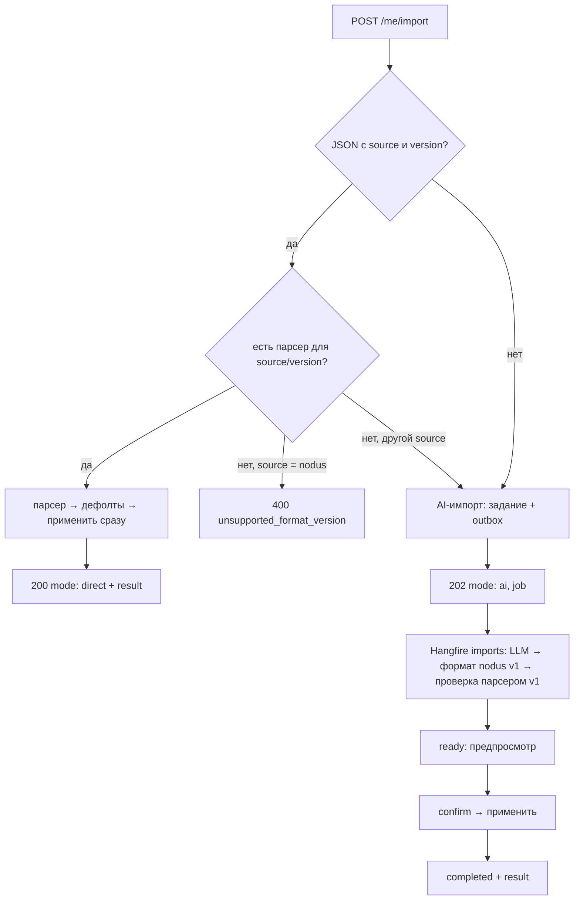

# Экспорт и импорт

Код: `Nodus.Api/DataPortability/`, выбор парсера — `Common/Resolvers/` (паттерн «стратегия», `ISelectionResolver` из eatee-backend).

Экспорт выгружает активные узлы в JSON-файл формата Nodus. Импорт принимает файл Nodus любой выпущенной версии или файл другого приложения: чужой файл AI приводит к текущему формату Nodus. Импорт **только добавляет** узлы: существующие не меняются, дубли и неактуальные записи пропускаются.

## API

| Запрос | Что делает |
|---|---|
| `GET /v1/me/export` | JSON-файл (`Content-Disposition: attachment; filename="nodus-export-YYYY-MM-DD.json"`) |
| `POST /v1/me/import` `{ content, file_name?, timezone? }` | импорт (`Idempotency-Key`, rate limit `ai`, тело до 1 МБ) |
| `GET /v1/me/imports/{id}` | статус AI-импорта и предпросмотр |
| `POST /v1/me/imports/{id}/confirm` `{ indexes? }` | подтвердить AI-импорт: все записи или выбранные по `index` |
| `POST /v1/me/imports/{id}/cancel` | отменить AI-импорт |

`content` — содержимое файла как строка: JSON, CSV, текст, что угодно. `timezone` — пояс для записей без пояса; по умолчанию текущий пояс пользователя (`PUT /v1/me/timezone`), затем UTC.

## Формат файла

Обязательные поля верхнего уровня — `source` и `version`. По этой паре всегда известно, каким парсером читать файл.

```json
{
  "source": "nodus",
  "version": 1,
  "exported_at": "2026-10-18T07:00:00+00:00",
  "timezone": "Europe/Moscow",
  "nodes": [
    { "type": "one_time", "title": "Купить подарок", "description": null, "timezone": "Europe/Moscow",
      "date": "2026-11-01", "time": "12:00", "recurrence": null, "track_years": null },
    { "type": "recurring", "title": "Зарядка", "description": null, "timezone": "Europe/Moscow",
      "date": null, "time": null,
      "recurrence": { "frequency": "daily", "interval": 1, "start_date": "2026-10-01", "until": null,
                      "times": ["07:30"], "week_days": [], "month_day": null },
      "track_years": null },
    { "type": "anniversary", "title": "ДР мамы", "description": null, "timezone": "Europe/Moscow",
      "date": "1965-03-08", "time": null, "recurrence": null, "track_years": true }
  ]
}
```

Поля узла v1 совпадают с [созданием узла](03-nodes-and-recurrence.md) (`type`, `title`, `description`, `timezone`, `date`, `time`, `recurrence`, `track_years`). Идентификаторов, состояний и истории в файле нет: файл переносит актуальный план, а не журнал.

### Дефолты при чтении (`nodus` v1)

Файл не отклоняется из-за пропусков; недостающие значения заполняются:

| Поле | Если нет или не распознано |
|---|---|
| `type` | `recurring`, если есть `recurrence`, иначе `one_time` |
| `timezone` узла | `timezone` документа → пояс из запроса → текущий пояс пользователя → `UTC` (неизвестный IANA-пояс считается отсутствующим) |
| `recurrence.interval` | `1` |
| `recurrence.start_date` | сегодня в поясе узла |
| `recurrence.times` | пусто — весь день |
| `recurrence.week_days` | пусто — день недели `start_date` |
| `track_years` | `true` для годовщины |
| `description`, `date`, `time`, `until`, `month_day` | `null` |

Отдельная запись отбрасывается с замечанием, если её нельзя превратить в узел: нет названия (`missing_title`), не элемент-объект (`invalid_node`), не проходит правила узла, например годовщина без даты (`invalid_node`). Остальные записи файла импортируются.

## Экспорт: что выгружается

Только **свои активные** узлы:

| Узел | В экспорте |
|---|---|
| удалённый | нет |
| одноразовый выполненный (развязан) | нет |
| одноразовый, дата/время которого прошли | нет |
| одноразовый в будущем или без даты | да |
| регулярный с истёкшим `until` | нет |
| регулярный действующий | да |
| годовщина | да |
| чужой узел, где пользователь участник | нет |

Регулярные выгружаются с текущим правилом; история ревизий и состояния экземпляров не переносятся.

## Импорт



### Применение (общая часть для обоих путей)

Для каждой записи по порядку:

1. Проверка правил узла (как при создании). Ошибка → замечание `invalid_node`.
2. **Актуальность** по тем же правилам, что и в экспорте: прошедшие одноразовые и закончившиеся серии пропускаются (`skipped_inactive`).
3. **Дедупликация.** Отпечаток — тип + нормализованное название + дата + время + правило; описание и пояс не учитываются. Совпадение с существующим активным узлом пользователя или с более ранней записью того же файла → `skipped_duplicates`.
4. Создание нового узла с новым id. Существующие узлы не изменяются никогда.

Всё — в одной транзакции, не больше `Import:MaxNodes` (1000) узлов за раз. Для импортированных узлов «Продолжение нити» не запускается, чтобы большой импорт не порождал сотни AI-задач. Узлы приходят на устройства через sync.

Результат:

```json
{ "created_nodes": 3, "skipped_duplicates": 1, "skipped_inactive": 2,
  "issues": [ { "index": 4, "title": null, "code": "missing_title", "message": "The node has no title." } ] }
```

Повторный импорт того же файла ничего не добавляет (`created_nodes: 0`, всё в `skipped_duplicates`). Повтор запроса с тем же `Idempotency-Key` возвращает тот же ответ.

### Файл Nodus: сразу

`200 { "mode": "direct", "format": "nodus/v1", "result": { … } }`.

Файл Nodus неизвестной версии (из более новой версии приложения) → `400 unsupported_format_version`, в AI не отправляется.

### Чужой файл: через AI и подтверждение

AI никогда не создаёт узлы сам, поэтому чужой файл сначала превращается в предпросмотр:

1. `POST /v1/me/import` → `202 { "mode": "ai", "job": { "id", "status": "queued" } }`. Нужны функция `ai_import` в плане и согласие на AI, иначе `403 feature_not_available` / `403 ai_consent_required` ([11-plans-and-features.md](11-plans-and-features.md)); файл Nodus от этого не зависит. Содержимое — до `Import:MaxAiInputChars` (30 000 символов, иначе `400 file_too_large_for_ai`); не больше `Import:MaxAiImportsPerDay` (5) в сутки (`429 ai_quota_exceeded`).
2. Задача в очереди `imports` отправляет текст модели через тот же [LLM-клиент с fallback](07-ai-drafts.md#llm-клиент-с-двумя-провайдерами). Промпт описывает формат Nodus v1 и требует переносить только то, что есть в файле, пропуская выполненное и архивное. Ответ принудительно получает `source: "nodus"` и текущую `version` и **проверяется тем же парсером v1** с теми же дефолтами.
3. Статус `ready` + push «Импорт готов к проверке» (`kind: import_ready`, `import_id`). Задание приходит в sync (`entity_type: import_job`):
   ```json
   { "id": "…", "status": "ready", "file_name": "todoist.csv",
     "preview": [ { "index": 0, "type": "one_time", "title": "Сдать отчёт", "date": "2026-10-25", "time": "10:00", … } ],
     "preview_issues": [], "result": null, "expires_at": "…" }
   ```
4. Пользователь проверяет и подтверждает всё или часть: `POST …/confirm { "indexes": [0, 2] }` → применение по правилам выше → `completed` с `result`.

Статусы: `queued → processing → ready → completed`; также `failed` (`ai_unavailable`, `ai_temporarily_unavailable`, `invalid_ai_response`, `nothing_recognized`, `timed_out`, `input_expired`), `cancelled`, `expired` (предпросмотр не подтверждён за `Import:PreviewRetentionDays`, 7 дней).

Текст файла стирается сразу после конвертации (успешной или нет) и не логируется. Временные ошибки модели повторяются до `Import:MaxAttempts` (3) раз. Жизненный цикл задания общий с голосовыми черновиками (`AiJobRunner`), итоги — в метрике `nodus.ai.jobs` с `kind=import`.

## Версии формата и парсеры

Каждая версия читается своим классом, реализующим единый интерфейс:

```csharp
public interface IImportFormatParser
{
    ImportFormat Format { get; }   // (Source, Version), например ("nodus", 1)
    ImportParseResult Parse(JsonElement document, ImportDefaults defaults);
}
```

Все реализации находятся сканированием сборки (Scrutor) и регистрируются в `ISelectionResolver<ImportFormat, IImportFormatParser>`, который выбирает парсер по точному совпадению `(source, version)`:

```csharp
services.AddSelectionResolver<IImportFormatParser, ImportFormat, ImportFormat>(
    parser => parser.Format, (key, input) => key == input, typeof(NodusApplication).Assembly);
```

### Как выпустить версию 2

1. Добавить модель `NodusDocumentV2` и перевести экспорт на неё.
2. Написать `NodusV2Parser : IImportFormatParser` с `Format = ("nodus", 2)` — регистрировать вручную не нужно.
3. Поднять `ImportFormat.CurrentVersion` до 2 (по нему работают экспорт и AI-конвертация) и обновить промпт и схему в `ImportRunner`.
4. **`NodusV1Parser` не удалять и не менять**: файлы, выгруженные старыми версиями, должны импортироваться всегда.

Аналогично можно добавить точный парсер для известного чужого формата (например, `("todoist", 1)`), и такие файлы будут импортироваться без AI.
